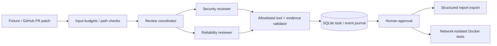

# AI Engineering Platform

Original educational reference implementation by Eric Wright. Extends transaction-oriented engineering discipline into agentic review: durable state, bounded tools, evidence validation, explicit approvals and observable outcomes. No employer systems, proprietary code or real customer data.

## Five-minute demo (no paid API keys)

Python 3.11+; no runtime dependencies:

```sh
python -m unittest discover -s tests -v
python -m engineering.cli demo
```

Two logical reviewer agents run concurrently: security flags a shell-injection fixture and reliability flags a swallowed exception. Findings carry severity, path, line, evidence and reviewer identity. The workflow rejects export before approval, explicitly simulates human approval, then prints the report and estimated token usage ($0 mock cost). Task state and structured event records persist in ignored `artifacts/tasks.db` (SQLite WAL). Repeating analysis returns its recorded content-addressed task.



## Explicit approval and sandbox demo

```sh
python -m engineering.cli analyze
# Copy task ID from result:
python -m engineering.cli approve TASK_ID --reviewer 'Your Name'
python -m engineering.cli export TASK_ID
# Pull trusted runtime deliberately; tests never implicitly pull:
docker pull python:3.12-slim
python -m engineering.cli test TASK_ID fixtures/sandbox
```

The test command is fixed (`python -I -m unittest discover -s tests -v`) and runs only in Docker, with read-only source/root filesystem, no network, no capabilities, unprivileged UID, PID/CPU/memory/time limits, and no host Docker socket or credential mount. The synthetic sandbox tests verify non-root execution, no token/socket, and read-only source. Do not mount sensitive directories. Containers share a kernel: this is a development boundary, not sufficient isolation for hostile public workloads; production should use dedicated ephemeral VMs/microVMs and trusted digest-pinned images. The CLI user is trusted to select a source directory and approve it. Docker daemon access is privileged. Never execute untrusted repository code on the host.

## GitHub integration

```sh
# Optional read-only GITHUB_TOKEN supplied securely through the environment.
python -m engineering.cli github OWNER/REPO PR_NUMBER
```

The adapter reads bounded GitHub PR patches over HTTPS with no redirects or writes. Evidence locations are **patch-line coordinates**, not original file coordinates. Oversized PRs, missing/binary patches and potentially truncated pages fail closed. Adapter behavior is tested with synthetic API responses; live GitHub API access is not required for the demo. This does not create comments, commits or PRs.

## Provider boundary and security

`Provider` is a protocol; `MockProvider` is deterministic and `JsonReplayProvider` accepts recorded completions. A hosted-provider adapter is future work, not an implemented capability. The only allowed tool is `submit_findings`; model output cannot select a process or execute commands. Fields, severity, source line evidence and budgets are checked before persistence. Prompt-injection text in the fixture is data only. Reports are JSON, never interpreted as HTML/shell. Usage records distinguish estimated tokens from actual metering; mock cost is zero in integer micro-USD. No claims of real LLM accuracy or savings are made.

## Architecture and limitations

See [ADR 001](docs/adr/001-trust-and-approvals.md). Nine automated tests exercise persistence/replay, evidence fabrication, malicious tool calls, path/budget controls, approval transitions and the GitHub adapter; sandbox contract is separately exercised in Docker. CI runs tests and the mock container. `docker build -t engineering-demo . && docker run --rm --network none engineering-demo` runs the mock demo in Docker.

Approvals are a local trusted-user workflow, not authenticated enterprise identity. SQLite is suitable for this single-process demo, not a distributed job queue. Two logical agents share a provider; they are not autonomous code-writing workers. There is no auto-merge, shell tool, production hosted model, OTLP exporter, billing reconciliation or distributed cancellation. Future work: authenticated approvals bound to a selected execution digest, provider version fingerprints, durable job leases, secret redaction, webhook verification, hosted providers and isolated VM execution. Token counts are estimates and prompts are intentionally small. Source is hashed but not stored in task payloads; evidence snippets are retained locally and should be treated as sensitive for non-fictional inputs.
